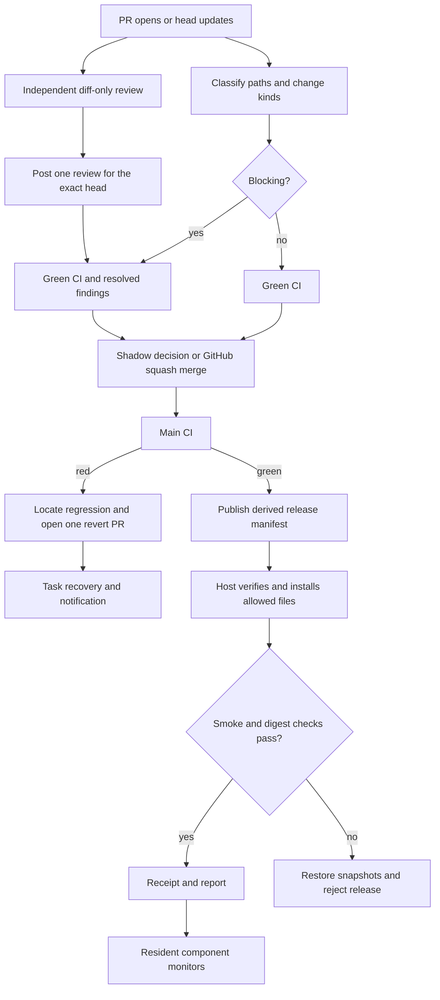

# Design

mergewake moves routine coordination into a small deterministic pipeline. A
repository owns the policy describing harm that can happen before a revert; a
host owns what it may install and which local model CLIs it may invoke. Neither
PR text nor a release manifest authorizes a host command.

## From PR open to a healthy fleet

A webhook adapter or scheduler can invoke `review` and `land` on PR events.
mergewake intentionally does not ship an HTTP webhook server. `watch` and `agent`
provide resident polling loops; `--once` supports an external scheduler. A green
watch result does not implicitly publish a release: the scheduler invokes
`release` after green CI. These are separate commands so release credentials
and installation authority can live on separate hosts.

## Package boundaries

| Package | Owns |
| --- | --- |
| `config` | Strict YAML, model-option validation, explicit host and repo selection. |
| `policy` | Slash-aware path globs, previous names on renames, change-kind matching. |
| `github` | Bounded HTTP requests and pagination, CI evidence, PR operations, inverse trees, release assets. |
| `pipeline` | Landing, one-pass review, CI diagnosis, release and rollout orchestration. |
| `manifest` | Deterministic inventories, SHA256 and size validation, safe relative paths. |
| `rollout` | Local exclusion, snapshots, durable journals, atomic per-file replacement, rollback. |
| `integrations` | CLI runner, notifier and task-sink interfaces and adapters. |
| `superfan` | Embedded prompts, allowed read-only sources and allowed actions. |

The command layer handles flags, signals, and polling. Tests replace each external
boundary with a fake or a local HTTP test server. Mutating operations have no
implicit HTTP retries: a timeout can leave a remote action's outcome uncertain.

## Policy and landing

Policy is fetched at the current base-branch commit, never from the PR head or
an untrusted checkout. Globs use `*`, `?`, character classes, and `**` as a complete
path segment; `**` spans zero or more segments. A rule matches any listed path
and any listed kind; omitting kinds means all kinds. Blocking wins over routine.
Renames test both the old and new names. Unknown kinds and empty change lists
classify as blocking. A truncated file list stops landing.

Every required named check must have an explicit successful result at the PR
head. Missing, queued, skipped, neutral, and ambiguous check/status evidence
cannot be green. A routine PR can merge before the advisory review finishes.
A blocking PR needs the trusted independent-review marker for that head, zero
unresolved review threads (including outdated ones), and no outstanding changes
requests. Reviewing a subsequent head is another single pass, not a review round.

Before acting, landing rechecks base policy revision, CI, PR readiness, and
blocking findings. GitHub's merge call includes the expected head SHA and squash
method. GitHub handles concurrent main changes and conflicts. There is no global
merge lock or forced rebase. Review resolution and the merge call cannot be one
GitHub transaction; a new finding can still race the final check. Native branch
rules remain available to a repository that requires stronger enforcement.

## Independent review

The author family is supplied by a trusted caller or the PR's
`Mergewake-Author-Family` trailer. It describes the underlying model, not the CLI
brand. Pairings map that family to ordered profiles from different families;
optional scopefuel gates can deny a candidate. The caller remains responsible
for truthful author metadata and profile-family declarations.

A server-side ref named `mergewake/reviews/<PR>/<head>` claims the pass before
model invocation. It prevents two hosts from spending on the same head. The
reviewer runs in an empty temporary directory, receives only the API diff on
stdin, and cannot request a checkout. pi runs without tools, MCP, extensions,
skills, context files or session history. Command Code uses safe mode, disabled
skills, a one-turn cap, deny-all permissions, and a deny-all tool hook. Profile
arguments are limited to model/provider/thinking/effort option-value pairs.
A configured wrapper can supply provider credentials, but it must preserve the
CLI name and these semantics.

The response must be a bounded JSON findings array. Paths and new-side line
numbers must exist in the supplied diff. mergewake checks that the PR head is
still the same and submits the marker and all inline comments in one review.
There is no second tester, fix round, or automatic retry on invalid model output.
A failed or interrupted review leaves its claim for operator inspection. The
adapter trusts installed CLI behavior; these switches are not an OS sandbox.
Diffs larger than 2 MiB and unsupported output need manual review.

## Main CI recovery

The watcher stores the last observed green head locally. On red main it walks
first-parent history, bounded by `watch_limit`, and checks existing CI evidence.
On first use it discovers a green ancestor. Later green evidence inside an older
checkpoint interval supersedes that checkpoint, avoiding attribution to an older,
recovered failure. The remaining green-to-red interval is bisected using cached
check results. Incomplete evidence stops attribution. The boundary must map to
one merged PR whose squash SHA and base branch agree with GitHub.

Reverting uses GitHub tree and commit APIs. For every changed path, its current
blob and mode must still equal the culprit's postimage. The new tree restores
that path's preimage while preserving unrelated main changes. Later edits on a
changed path, non-regular files, ambiguous PR mappings, or non-linear history
require an operator. This is deliberately more conservative than applying fuzzy
reverse patches. The watcher opens a revert PR; it never auto-merges one.

The fixed `mergewake-recovery-latch` Git tag is created by an exclusive Git-ref
operation before creating the `mergewake/recovery` branch. It is a repository-wide
latch across watcher hosts and survives GitHub's automatic deletion of merged PR
branches. Clearing the tag and any remaining branch is the operator's explicit
authorization for another recovery. A leftover branch also stops recovery even
when its tag is absent. If branch or PR creation fails after the tag exists, the
latch remains. No distributed service or lease system is needed.

After opening a revert, the sink records recovery and attempts to reopen the
origin task, and the notifier posts an event with a deterministic ID. A
`Mergewake-Task` PR trailer selects the task, with a configured repo task as a
fallback. The handoffkeep adapter uses show, comment, then transition. Its current
upstream state machine prohibits terminal reopening: the comment survives, the
error is returned and included in the notification, and the latch stays set.
This limitation needs an upstream API or another Sink implementation.

## Manifests and verified installs

A release commit must have green required checks and be an ancestor of the
configured main branch. Sources come from regular Git blobs at that full SHA,
not the local working tree. The manifest is deterministic and contains schema
version, repo, commit, source path, target path, byte length, SHA256, and mode.
Only `0644` and `0755` are supported. Overlapping file targets are rejected.
The tag is `mergewake-<full-SHA>` and the asset is `mergewake-manifest.json`.

Publication reserves the commit tag, creates a draft release, uploads the
manifest, then publishes it. Interrupted drafts can be resumed with identical
content. Existing manifests and tags are never replaced. Manifests are derived
assets; nothing writes hash pins or generated inventories back into Git.

Hosts fetch the newest published mergewake release and confirm the asset's repo,
SHA, tag, current main ancestry, and green checks. A receipt prevents automatic
downgrades or divergent releases. The host's inventory must independently match
each permitted source, target, and mode. Deny patterns override the inventory;
denied files are never fetched, changed, or smoke-installed. No permitted targets
means refusal. Source deletion does not imply target deletion.

Installation has these steps:

1. Canonicalize the configured root and refuse symlinks beneath it.
2. Acquire a host-local per-repo directory lock and recover an unfinished journal.
3. Verify current receipts and real bytes; return quietly when already healthy.
4. Download and verify all permitted bytes before changing any target.
5. Snapshot previous bytes, permissions, existence, and the previous receipt.
6. Persist a rollback journal, then replace each file with a same-directory rename.
7. Run the configured smoke command with a timeout, then verify installed bytes and modes.
8. Persist the receipt, remove the journal, and report the result.

On write, smoke, or post-install verification failure, rollback restores prior
bytes and permissions and removes newly created files. It also restores the old
receipt, including after a crash between receipt creation and journal removal.
A rejection receipt prevents repeatedly trying a release that rolled back. If
rollback fails, evidence remains on disk and installation fails visibly. Dry
runs validate the manifest and permitted plan but do not download all payloads,
check live smoke behavior, lock, or write state.

File replacement is atomic per file, not across the entire inventory. Processes
can observe a mixed version during replacement. No service restarts, migration
rollbacks, or reversal of smoke-command side effects are attempted. Keep smoke
commands read-only and use dedicated roots without competing writers. The local
lock does not serialize two differently configured repos targeting the same root;
operators must give each inventory its own root.

## Failure boundaries and omissions

- Missing policy, incomplete API pagination, malformed data, and uncertain CI
  produce errors rather than permission to act. Resident loops log errors and
  poll again; once commands return a failing exit status.
- A crash leaves a local lock. Operators must inspect the process and journal
  before removing the stale lock. The next acting rollout restores the journal
  before starting another attempt; dry runs never perform recovery.
- Audit records, GitHub operations, task updates, and notifications cannot commit
  together. Reporting errors are returned, but there is no durable outbox or
  cross-host replay. Inspect the retained GitHub latch and local audit after
  partial failures. Unknown HTTP outcomes require inspection, not blind retries.
- The release asset is authenticated through GitHub and checked against Git
  contents and a tag. There is no signature, transparency log, or offline trust
  root; repository writers and host config owners are trusted.
- Install sources are Git-backed regular files. Building and uploading binary
  payloads, package managers, remote host execution, service supervision, database
  migrations, deployment windows, and fleet-wide canaries are outside this version.
- CI recovery uses recorded checks; any-ref workflow dispatch and flaky-test
  reruns are not implemented. Missing evidence deliberately requires an operator.
- Superfan contracts guide a trusted session runner; the binary neither enforces
  an external agent's capability boundary nor manages its session lifetime.
  There is no autonomous privileged monitor by default.
- All four builds disable CGO. Linux outputs are statically linked; Darwin outputs
  retain macOS system-library dependencies. Fully static Darwin executables are
  not provided.
- No git replacement, source-control server, global merge queue, lease framework,
  multi-round review manager, or integration-source imports are included.

These constraints keep the first release reviewable while providing real API
operations, durable local rollback, and an explicit path from shadow observation
to operator-approved activation.
